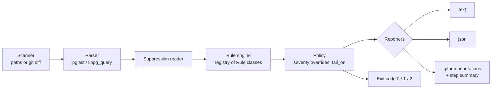

# MigrationGuard

[](https://github.com/ktk-007/migration-gaurd/actions/workflows/ci.yml)

**A CI check that stops dangerous PostgreSQL migrations before review.**

A migration that drops a column, rewrites a big table or builds an index the
blocking way can pass code review and still take production down. MigrationGuard
runs on every pull request, parses each changed `.sql` migration with the real
PostgreSQL parser, and fails the check when it finds a risky operation. Every
finding says what is risky, where, and what to do instead.

<!-- After opening the demo PRs, add a screenshot of the failing check here:
 -->

## Quickstart

```bash
git clone https://github.com/ktk-007/migration-gaurd.git
cd migration-gaurd
python -m venv .venv
# Windows: .venv\Scripts\activate    macOS/Linux: source .venv/bin/activate
pip install -e ".[dev]"

migration-guard --version
migration-guard rules
migration-guard check examples/unsafe_migrations
```

Real output of the last command (run from the repository root, so the repo's
`.migrationguard.yml` raises MG006 to HIGH):

```text
examples/unsafe_migrations/0002_drop_email.sql:2  MG003  HIGH  DROP_COLUMN  users.email  [BLOCKING]
    Dropping column 'email' from 'users' permanently removes its data, and application versions still running may read it.
    Fix: Use expand-and-contract: (1) add the new column/table, (2) deploy code that reads and writes both, (3) backfill existing rows in batches, (4) switch reads and writes to the new one, (5) verify nothing uses the old one, (6) remove it in a later migration.

examples/unsafe_migrations/0003_drop_payments.sql:2  MG001  CRITICAL  DROP_TABLE  payments  [BLOCKING]
    Dropping table 'payments' permanently deletes the table and all its data.
    Fix: Confirm no service still reads or writes it, take a backup or archive the data, and drop it in a separate, reviewed migration.

examples/unsafe_migrations/0004_mixed.sql:2  MG005  HIGH  ADD_COLUMN_NOT_NULL  orders.region  [BLOCKING]
    Adding NOT NULL column 'region' without a DEFAULT fails on any table that already has rows ('orders').
    Fix: Add the column as nullable (or with a DEFAULT), backfill existing rows, then add the NOT NULL constraint in a later migration.

examples/unsafe_migrations/0004_mixed.sql:4  MG006  HIGH  CREATE_INDEX  orders.idx_orders_region  [BLOCKING]
    Building index 'idx_orders_region' on 'orders' without CONCURRENTLY blocks all writes to the table until the build finishes.
    Fix: Use CREATE INDEX CONCURRENTLY. Note that CONCURRENTLY cannot run inside a transaction block, which many migration tools use by default, so run it in its own non-transactional migration.

examples/unsafe_migrations/0004_mixed.sql:7  MG007  HIGH  DELETE_ALL_ROWS  order_cache  [SUPPRESSED]
    DELETE on 'order_cache' has no WHERE clause, so it touches every row.
    Suppressed: one-off reset of a cache table, approved by on-call

------------------------------------------------------------
Files: 3   Statements: 5   Findings: 5 (blocking 4, suppressed 1)   Errors: 0
By severity: CRITICAL 1, HIGH 4, MEDIUM 0, LOW 0
Policy: block at HIGH and above
Result: BLOCKED
```

## Usage

```bash
migration-guard check PATH [PATH ...]                     # files or directories
migration-guard check migrations --format json --output report.json
migration-guard check migrations --changed-since origin/main --format github
migration-guard check migrations --config .migrationguard.yml --fail-on CRITICAL
migration-guard rules                                     # list all rules
migration-guard --version
```

| Option | Meaning |
|---|---|
| `--config FILE` | Policy file. Default: `./.migrationguard.yml` if it exists, otherwise built-in defaults. |
| `--format text\|json\|github` | Report format (default `text`). |
| `--output FILE` | Also write the report to a file. |
| `--changed-since REF` | Only check `.sql` files added, copied, modified or renamed since `REF` (`git diff REF...HEAD`). |
| `--fail-on SEVERITY` | Block at this severity and above. Overrides the config. |

### Exit codes

| Code | Meaning |
|---|---|
| `0` | No blocking findings. |
| `1` | At least one blocking finding. |
| `2` | Tool failure: unparseable SQL, unreadable file, invalid config, bad suppression, missing path or git ref. |

Exit code 2 always wins. MigrationGuard **fails closed**: SQL it could not
analyse is never treated as safe.

## Rules

| ID | Detects | Default severity | Why it is risky |
|---|---|---|---|
| MG001 | `DROP TABLE` | CRITICAL | Deletes the table and its data permanently. |
| MG002 | `TRUNCATE` | CRITICAL | Removes every row instantly. |
| MG003 | `DROP COLUMN` | HIGH | Data loss; running app versions may still read it. |
| MG004 | `ALTER COLUMN ... TYPE` | HIGH | Can rewrite the table under an ACCESS EXCLUSIVE lock. |
| MG005 | `ADD COLUMN ... NOT NULL` without `DEFAULT` | HIGH | Fails on any table that already has rows. |
| MG006 | `CREATE INDEX` without `CONCURRENTLY` | MEDIUM | Blocks writes for the whole build. |
| MG007 | `DELETE` / `UPDATE` without `WHERE` | HIGH | Touches every row; usually a mistake. |
| MG008 | `ADD FOREIGN KEY` / `CHECK` without `NOT VALID` | MEDIUM | Validates every row while holding a lock. |
| MG009 | `ALTER COLUMN ... SET NOT NULL` | MEDIUM | Full table scan under ACCESS EXCLUSIVE lock. |
| MG010 | `RENAME COLUMN` / `RENAME TABLE` | MEDIUM | Breaks running application code instantly. |

Deliberately **not** flagged (each has a test): `CREATE TABLE`, nullable
`ADD COLUMN`, `ADD COLUMN` with a `DEFAULT` or identity, `CREATE INDEX
CONCURRENTLY`, `DELETE`/`UPDATE` with `WHERE`, `NOT VALID` constraints,
`SELECT`/`INSERT`, and any dangerous keyword inside a comment or string literal.

## Configuration

`.migrationguard.yml`:

```yaml
version: 1
dialect: postgres
fail_on: HIGH            # findings at or above this severity block the PR
ignore_paths:            # globs relative to where the tool runs; ** crosses folders
  - "migrations/legacy/**"
rules:
  MG006:
    severity: HIGH       # override a rule's severity
  MG010:
    enabled: false       # turn a rule off
```

The config is validated strictly: unknown keys, unknown rule IDs, unknown
severities, another dialect or another version number are errors (exit 2), so a
typo can never silently weaken the policy.

## Suppressing a finding

Put a comment directly above the statement. A reason is required:

```sql
-- migration-guard: ignore MG003 reason="column unused since v2.3"
ALTER TABLE users DROP COLUMN legacy_flag;
```

- Several rules: `ignore MG003, MG004 reason="..."`.
- Only the statement directly below is covered; a blank line ends the block.
- Suppressed findings still appear in every report (with the reason) but never block.
- A missing reason, an unknown rule ID or a malformed directive is exit code 2.

## Output formats

- **text**: the terminal report shown above.
- **json**: the `AnalysisResult` model from `migration_guard/models.py`, with
  `schema_version`. Includes recommendations, so other tools and coding agents
  can act on findings. Real example, reflowed to fit the page and with the
  recommendation shortened (the tool prints one field per line):

```json
{
  "schema_version": "1",
  "tool_version": "0.1.0",
  "fail_on": "HIGH",
  "files": ["examples/unsafe_migrations/0002_drop_email.sql"],
  "summary": {"files": 1, "statements": 1, "findings": 1, "blocking": 1, "suppressed": 0, "errors": 0,
              "by_severity": {"LOW": 0, "MEDIUM": 0, "HIGH": 1, "CRITICAL": 0}},
  "findings": [
    {
      "rule_id": "MG003", "severity": "HIGH", "category": "DATA_LOSS", "operation": "DROP_COLUMN",
      "table": "users", "object": "email",
      "file": "examples/unsafe_migrations/0002_drop_email.sql", "statement_index": 1, "line": 2,
      "blocking": true, "suppressed": false, "suppression_reason": null,
      "message": "Dropping column 'email' from 'users' permanently removes its data, and application versions still running may read it.",
      "recommendation": "Use expand-and-contract: (1) add the new column/table, ..."
    }
  ],
  "errors": [],
  "verdict": "BLOCKED",
  "exit_code": 1
}
```

- **github**: workflow commands that become inline annotations on the PR diff
  (`::error` for blocking, `::warning` for non-blocking, `::notice` for
  suppressed), plus a Markdown table appended to `$GITHUB_STEP_SUMMARY`. Real example:

```text
::error file=examples/unsafe_migrations/0003_drop_payments.sql,line=2,title=MG001 CRITICAL%3A DROP_TABLE::Dropping table 'payments' permanently deletes the table and all its data.%0AFix: Confirm no service still reads or writes it, take a backup or archive the data, and drop it in a separate, reviewed migration.
MigrationGuard: BLOCKED - 1 file(s), 1 statement(s), 1 finding(s), 1 blocking, 0 error(s)
```

## GitHub Actions

Two workflows live in `.github/workflows/`:

- `ci.yml` runs `ruff check`, `ruff format --check` and `pytest` with coverage on
  every push and pull request, for the tool itself.
- `migration-check.yml` runs on pull requests that touch `migrations/` and
  checks **only the migration files changed in the PR**:

```yaml
- uses: actions/checkout@v4
  with:
    fetch-depth: 0          # a shallow clone cannot diff against the base branch
- run: pip install .
- run: >
    migration-guard check migrations
    --changed-since origin/${{ github.base_ref }}
    --format github
```

Checking only changed files means an old, already-applied migration can never
fail an unrelated PR, and the check stays fast as the folder grows.

**Make it a required check:** Settings → Branches → Add branch protection rule
(or Rules → Rulesets) for `main` → enable "Require status checks to pass" →
select `migration-guard`. On the free plan this needs a public repository.

### Demo pull requests

`migrations/0001_create_users.sql` is the baseline. Open three PRs from
branches, copying one example file into `migrations/` each time:

```bash
git checkout -b demo/safe-add-column
cp examples/safe_migrations/0002_add_last_login.sql migrations/
git add migrations && git commit -m "Add users.last_login" && git push -u origin HEAD
# open the PR on GitHub: the check passes

git checkout main && git checkout -b demo/drop-column
cp examples/unsafe_migrations/0002_drop_email.sql migrations/
git add migrations && git commit -m "Drop users.email" && git push -u origin HEAD
# open the PR: fails with a HIGH annotation on the line

git checkout main && git checkout -b demo/drop-table
cp examples/unsafe_migrations/0003_drop_payments.sql migrations/
git add migrations && git commit -m "Drop payments" && git push -u origin HEAD
# open the PR: fails with CRITICAL; branch protection blocks the merge
```

## Architecture



```text
migration_guard/
  cli.py            Typer CLI: check, rules, --version
  scanner.py        which .sql files to check (paths, or --changed-since via git)
  parser.py         SQL -> statements with index and exact line number
  suppressions.py   "-- migration-guard: ignore" comments
  analyzer.py       runs enabled rules, applies policy, computes verdict
  config.py         strict .migrationguard.yml models
  models.py         Severity, Finding, AnalysisResult (also the JSON schema)
  rules/            base.py, registry.py, destructive.py, locking.py, data.py
  reporters/        text.py, json_report.py, github.py
```

More detail in [docs/DESIGN.md](docs/DESIGN.md).

## Design decisions and trade-offs

- **Real parser, never regex.** pglast wraps libpg_query, the parser PostgreSQL
  itself uses. Regex flags `DROP TABLE` inside comments and strings and misses
  variants such as `DROP TABLE IF EXISTS a, b`. The AST also exposes exactly the
  flags rules need (`IndexStmt.concurrent`, `Constraint.skip_validation`).
- **Fail closed.** CI must distinguish "your migration is risky" (exit 1) from
  "the tool could not check it" (exit 2). Treating unparseable SQL as safe would
  let anything through.
- **Severity is separate from enforcement.** Rules describe risk; each team's
  policy (`fail_on`, overrides) decides what blocks. Teams can start lenient and
  tighten over time without changing rules.
- **One class per rule.** A rule only inspects an AST node. Files, line numbers,
  policy and suppression are handled by the analyzer, so adding a rule is one
  class plus tests, and the analyzer never changes.
- **Mandatory suppression reasons.** Skipping a safety check should leave a
  reviewable record of why.

## Limitations

- Static analysis cannot prove an application is compatible with a schema
  change, or that a migration is safe on production data volumes.
- Raw `.sql` files and PostgreSQL only. Django and Alembic can emit SQL, which
  can then be checked, but there is no direct integration.
- No analysis of lock timeouts, lock queues behind long-running transactions, or
  table sizes.
- No knowledge of earlier statements: `CREATE INDEX` on a table created in the
  same migration is flagged by MG006 even though that table is empty.
- `ignore_paths` globs are matched against paths relative to the directory the
  tool runs in (the repository root in CI).

## Roadmap

- Pre-commit hook and a reusable GitHub Action (`uses: ktk-007/migration-gaurd@v1`).
- Django and Alembic migration support via their generated SQL.
- More dialects (MySQL) behind the same rule interface.
- Context across statements, so objects created in the same migration are not flagged.

## Development

```bash
pip install -e ".[dev]"
ruff check . && ruff format --check .
pytest --cov=migration_guard
```

## License

MIT
